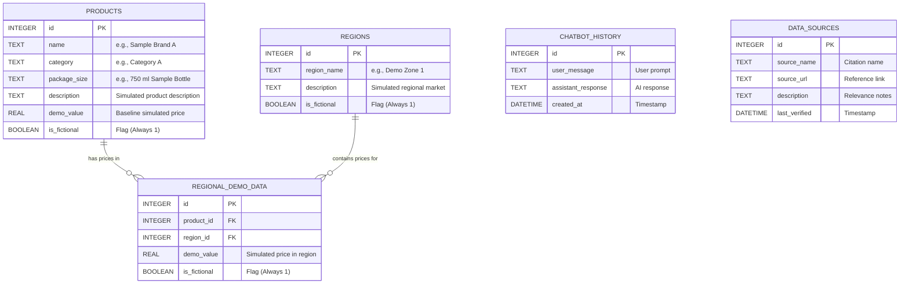

# NCRB BOOZE COMPARE

> **COLLEGE DEMONSTRATION PROJECT — FICTIONAL DATA ONLY**  
> All product records, prices, and regional comparisons are strictly simulated demonstration data created for educational evaluation. Not intended for commercial release, live pricing, or purchasing assistance.

---

## 1. Project Information

- **Project Name:** NCRB BOOZE COMPARE
- **Student Name:** Prashant Pandey
- **Project Type:** College Academic Project (Educational & Academic Demonstration)
- **Application Type:** Full-Stack Web Application (React.js + Tailwind CSS + Python Flask + SQLite3)
- **Purpose:** Demonstrate product comparison algorithms, geographic price variance simulation, Chart.js analytics, relational database management, and AI chatbot integration with safety guardrails.

---

## 2. Technology Stack

### Frontend
- **Framework:** React.js 18 (Vite SPA)
- **Styling:** Tailwind CSS with modern dark slate theme
- **Icons:** Lucide React
- **Visualizations:** Chart.js & React-Chartjs-2 (Bar, Pie/Doughnut, Line charts)
- **Routing:** React Router v6
- **HTTP Client:** Axios with backend proxy

### Backend
- **Language & Framework:** Python 3.14 + Flask 3.1
- **API Architecture:** RESTful API with Flask Blueprints
- **CORS:** Flask-CORS for cross-origin resource sharing
- **Environment Management:** python-dotenv

### Database
- **Engine:** SQLite3 (`database/ncrb_demo.db`)
- **Query Method:** 100% Parameterized SQL queries preventing SQL injection
- **Data Integrity:** Foreign key enforcement (`PRAGMA foreign_keys = ON`)

### AI Chatbot
- **Engine:** NCRB AI ASSISTANT
- **Dual Architecture:** OpenAI / Gemini API integration when `.env` is configured + comprehensive built-in offline academic knowledge engine for viva presentations
- **Compliance Filter:** Automated regex interceptor refusing real-world purchase requests, liquor store directions, or commercial pricing inquiries

---

## 3. Project Architecture

```mermaid
flowchart TD
    subgraph Frontend ["React.js Single Page Application (Port 5173)"]
        UI_Nav["Navbar & Responsive Sidebar"]
        UI_Pages["Pages: Home, Dashboard, Comparison, Region Demo, Analytics, Awareness, About, Admin"]
        UI_Charts["Chart.js Dynamic Graphs"]
        UI_Chat["NCRB AI Assistant (Floating & Full Page)"]
    end

    subgraph Backend ["Python Flask REST API (Port 5000)"]
        API_Gateway["API Router (/api/...)"]
        Prod_Route["/api/products (CRUD)"]
        Reg_Route["/api/regions & /api/regions/demo-data"]
        Comp_Route["/api/comparison & /api/analytics"]
        Bot_Route["/api/chatbot & /api/chatbot/history"]
        Admin_Route["/api/admin/reset"]
        AI_Engine["NCRB AI Assistant Core + Offline Knowledge Engine"]
    end

    subgraph Storage ["SQLite Database"]
        DB_File[("database/ncrb_demo.db")]
    end

    Frontend -->|HTTP / JSON (REST)| Backend
    API_Gateway --> Prod_Route
    API_Gateway --> Reg_Route
    API_Gateway --> Comp_Route
    API_Gateway --> Bot_Route
    API_Gateway --> Admin_Route
    Bot_Route --> AI_Engine
    Backend -->|Parameterized SQL| DB_File
```

---

## 4. Relational Database Design



---

## 5. Main Application Modules

1. **Home Page (`/`)**: High-impact landing page featuring academic credentials, persistent demo disclaimer, quick KPI preview, and featured sample catalog cards.
2. **Dashboard (`/dashboard`)**: Executive dashboard with 4 metric cards (Total Products, Categories, Zones, Avg Value), Regional Average Bar Chart, and Category Doughnut Chart.
3. **Product Comparison (`/compare`)**: Side-by-side attribute comparison table (2 to 4 products) displaying package sizes, simulated base values, regional zone breakdowns, and lowest/highest difference badges.
4. **Regional Demo (`/regions`)**: Zone selector (Demo Zones 1–4) with comparative deviation analytics and full price breakdown matrix.
5. **Analytics Studio (`/analytics`)**: Interactive Chart.js studio with Bar chart, Pie chart, and Line progression curve.
6. **Alcohol Awareness (`/awareness`)**: Educational module detailing Minimum Legal Drinking Age (MLDA) laws across Delhi NCR/India, medical liver/metabolic risks, and toll-free helplines (Tele-MANAS, KIRAN 1800-599-0019).
7. **NCRB AI Assistant (`/chatbot`)**: Dual-engine academic assistant available as a full-page chat and a floating interactive modal. Politely refuses real-world liquor shopping requests.
8. **Admin Portal (`/admin`)**: Create, Read, Update, Delete (CRUD) operations on demo records, plus one-click "Reset Demo Database" functionality.
9. **About & Viva Guide (`/about`)**: Complete project summary, student credentials (Prashant Pandey), system architecture breakdown, and top 6 viva questions and model answers.

---

## 6. Installation & Execution

### Prerequisites
- Python 3.10+ (Tested on Python 3.14)
- Node.js 18+ & npm (Prebuilt standalone included in `.node/`)

### Step 1: Backend Setup
```bash
# 1. Create and activate virtual environment
python3 -m venv venv
source venv/bin/activate  # On Windows: venv\Scripts\activate

# 2. Install dependencies
pip install -r backend/requirements.txt

# 3. Initialize and seed SQLite database
python backend/seed_data.py

# 4. Start Flask server
python backend/app.py
# Backend runs at http://localhost:5000
```

### Step 2: Frontend Setup
```bash
# 1. Navigate to frontend directory
cd frontend

# 2. Install dependencies
npm install

# 3. Start Vite development server
npm run dev
# Frontend runs at http://localhost:5173
```

---

## 7. College Viva Presentation Checklist & Questions

- **Student:** Prashant Pandey
- **Topic:** Full-Stack Product Comparison with Regional Analytics and Ethical AI Integration
- **Key Concepts:** Client-Server decoupling, Parameterized SQLite queries, Chart.js dynamic data binding, AI safety prompt guardrails.

### Top Viva Questions & Answers:
1. **Q: Why does the project use fictional sample data?**  
   *A:* To comply with academic safety standards and avoid promoting commercial alcohol brands or facilitating alcohol purchases.
2. **Q: How does the comparison logic highlight differences?**  
   *A:* The backend computes min, max, and variance values across selected product IDs, while the React UI dynamically applies highlight badges to the lowest and highest values.
3. **Q: How is the AI chatbot prevented from assisting with real alcohol purchases?**  
   *A:* The backend intercepts queries matching purchase/location keywords (`buy`, `near me`, `liquor shop`, `theka`, `order`, etc.) and returns an academic compliance refusal notice.

---

## 8. License & Academic Disclaimer

This project is created by **Prashant Pandey** exclusively for academic evaluation and educational demonstration. It is not affiliated with any government excise department or commercial retailer.
